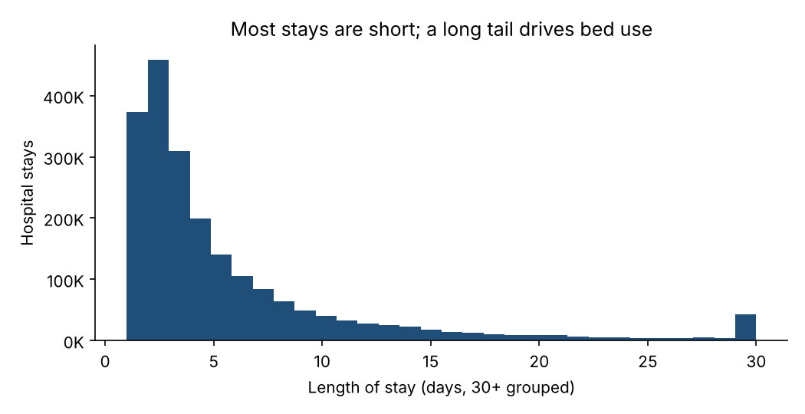
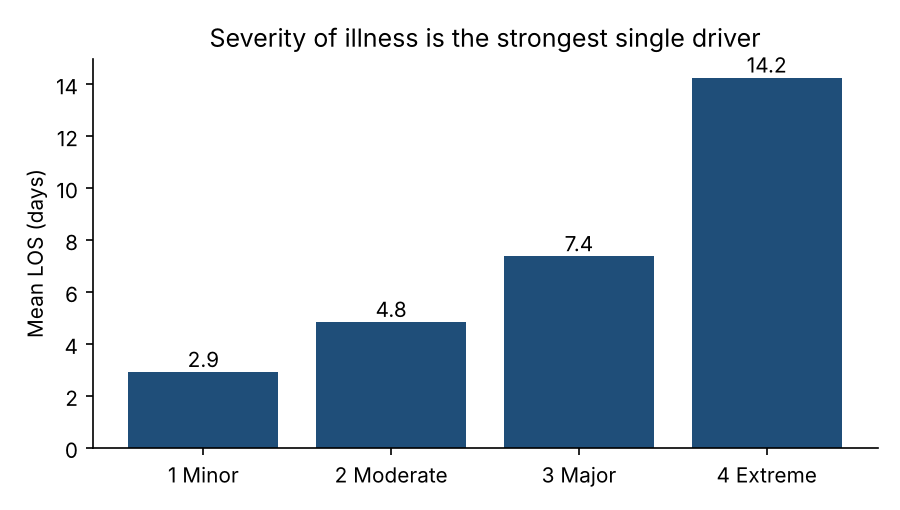
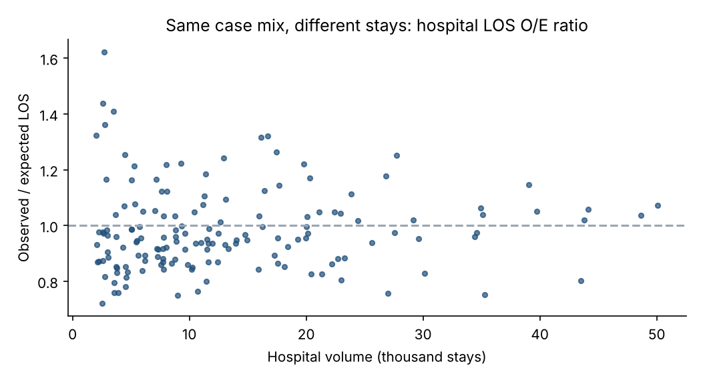
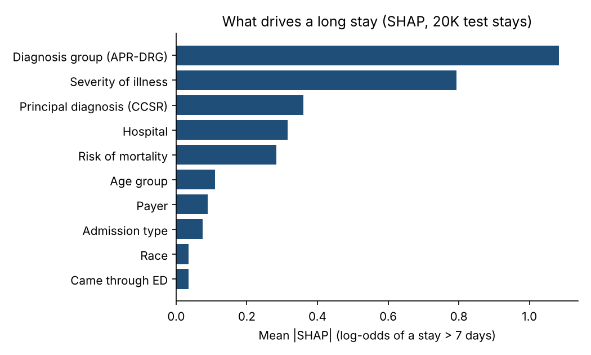
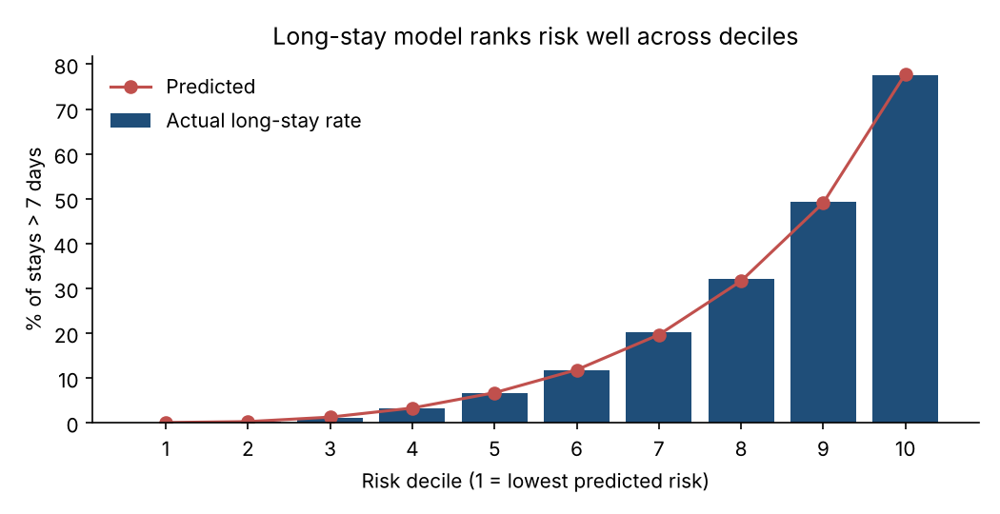

# Hospital Length-of-Stay Prediction (NY SPARCS 2022)

Predicting how long a patient will stay in the hospital, and flagging stays likely to run longer than a week, using **2.1 million real, de-identified inpatient discharges** from New York State (SPARCS 2022).

Bed capacity is planned around length of stay (LOS). A small share of long stays uses most of the bed days, so knowing early which patients are likely to stay long helps with discharge planning, staffing and bed management.

## Results (held-out test set: 419,105 stays)

| Task | Baseline (APR-DRG × severity average) | XGBoost |
|---|---|---|
| LOS in days, mean absolute error | 3.33 days | **2.98 days** (10% lower) |
| LOS in days, R² | 0.37 | **0.42** |
| Long stay (> 7 days), ROC-AUC | 0.867 | **0.893** |
| Long stay, PR-AUC | 0.631 | **0.697** |
| Long stay, recall in top 20% of risk scores | 58.6% | **62.8%** |

- 20.2% of stays last more than 7 days, but they account for **59.6% of all bed days**.
- The 20% of stays the model flags as highest risk are long stays **63.5%** of the time (3.1x the base rate) and contain **49%** of all test-set bed days.
- The baseline is deliberately strong: it is the same benchmark hospitals use for expected LOS (diagnosis group × severity).

## Key findings



- **Median stay is 3 days; mean is 5.8; 90th percentile is 13.** The long tail drives bed use.
- **Severity of illness** is the strongest single driver: mean LOS rises from 2.9 days (minor) to 14.2 days (extreme), and the long-stay rate from 5% to 58%.
- **Age:** patients 70+ stay 6.8 days on average, and 27.6% stay longer than a week, compared with 8.3% of children.
- **Septicemia** alone accounts for over 1 million bed days, the most of any diagnosis group. **Schizophrenia** stays average 18.8 days.
- **Hospitals differ even after adjusting for case mix.** Comparing each hospital's observed LOS with the LOS expected for its own mix of diagnoses and severity (O/E ratio), the middle 80% of large hospitals range from 0.83 to 1.18. The 28 hospitals above 1.10 used about **600,000 more bed days** than expected.




## What drives a long stay (SHAP)



Diagnosis group and severity dominate, followed by the principal diagnosis, **the hospital itself**, risk of mortality and age. Payer and admission type add smaller effects.



## Data

- Source: [Hospital Inpatient Discharges (SPARCS De-Identified): 2022](https://health.data.ny.gov/d/5dtw-tffi), New York State Department of Health. 2,103,433 discharges, 23 columns used.
- Validation (`src/01_load_validate.py`): every row is checked for missing or invalid LOS, admission type, diagnosis/DRG, severity, facility, gender and charges. **7,908 rows (0.38%)** failed at least one check and were excluded; counts per check are in `outputs/tables/rejected_rows_summary.csv`. Stays recorded as "120 +" days (2,087) are capped at 120.
- Raw data is not committed (130 MB). `src/00_download.py` downloads it from the state API.

## Method

- **Features:** age group, gender, race, ethnicity, admission type, region, hospital, principal diagnosis (CCSR), APR-DRG, body system (MDC), severity of illness, risk of mortality, medical/surgical, payer, ED admission.
- **Leakage control:** patient disposition, total charges and total costs are known only at discharge, so they are **not** used as features.
- **Split:** 72% train / 8% validation (early stopping) / 20% test, stratified on long stay, seed 42.
- **Models:** XGBoost with native categorical handling. Regression is trained on log(1 + LOS) with a smearing correction back to days. The classifier predicts LOS > 7 days.
- **Explainability:** TreeSHAP contributions on 20,000 test stays.

**Limitation:** APR-DRG, severity and risk of mortality are finalized by coders at discharge. In a live system you would use the working DRG assigned at admission, so real-time accuracy would be somewhat lower than reported here.

## Outputs

| Folder | Contents |
|---|---|
| `outputs/charts/` | 7 charts (distribution, severity, age, top DRGs, hospital O/E, SHAP, risk deciles) |
| `outputs/tables/` | Power BI-ready CSVs: LOS by hospital (with O/E ratio), DRG, MDC, severity, age, payer, admission type; model results; SHAP importance; error by LOS band; validation log |

## Run it

```bash
pip install -r requirements.txt
./run_all.sh
```

Training takes about 2 minutes on a 2-core laptop.

---
Bhargav Peddi · [Medium](https://medium.com/@bhargavpeddi)
